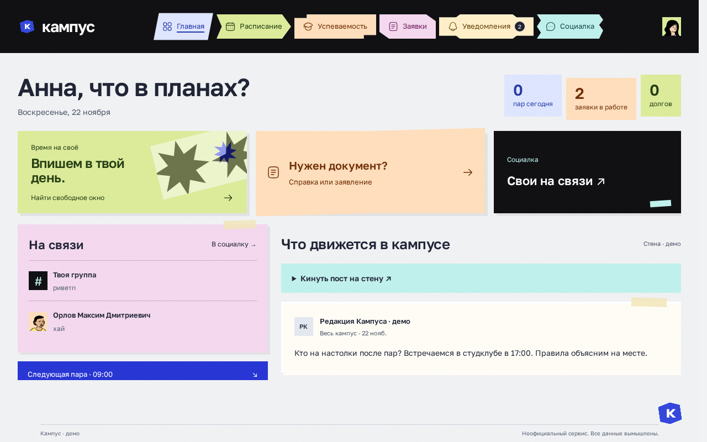

# Кампус

Конкурсный прототип «цифрового деканата будущего»: расписание, успеваемость, справки, уведомления и личный план в одном кабинете. Всё работает в браузере и на телефоне от 360 px.

**[Открыть опубликованный прототип → campus.mxd.wtf](https://campus.mxd.wtf)** · **[Отчёт о создании (PDF)](docs/creation-process.pdf)** · **[Исходный код](https://github.com/wolfhaley-48/campus)**

Это неофициальный концепт для конкурса. Все студенты, преподаватели, оценки и документы вымышлены. Знак «К» создан для проекта и не копирует логотип вуза.



Финальные исправления нижнего куба и проверки ответа ИИ опубликованы на `campus.mxd.wtf`; рабочая база при выкладке не сбрасывалась.

## Доступ для жюри

| Логин | Пароль | Сценарий |
| --- | --- | --- |
| `anna` | `kampus2026` | Анна Смирнова, 3 курс, ПИ-23-1, факультет цифровых технологий. Пять семестров, без долгов. |
| `maksim` | `kampus2026` | Максим Орлов, 2 курс, ЭК-24-2, факультет экономики и управления. Три семестра, долги и просроченные дела. |

На входе можно выбрать демо-аккаунт кнопкой. Данные студентов различаются и разделены сервером. Кабинета сотрудника в прототипе нет.

### Что посмотреть за пять минут

1. Войдите под `anna`. На главной — ближайшая пара, сроки, свои дела, чаты и стена.
2. Откройте **Расписание**: сегодня, вся неделя, аудитории и преподаватели, заметные переносы и отмены. Лента недель прокручивается в обе стороны.
3. В **Успеваемости** переключите семестр, раскройте дисциплину, посмотрите зачёты и сессию. Средний балл за всё обучение остаётся виден.
4. В **Заявках** нажмите «Новая заявка», выберите документ и способ получения, отправьте кнопкой или сдвигом. Откройте заявку и обновите страницу: статус и история сохраняются. У готовой электронной справки скачайте демонстрационный PDF.
5. В **Уведомлениях** отфильтруйте объявления и отметьте прочитанное. В **Плане** выберите свободное время между парами и сохраните задачу.
6. Выйдите через профиль и войдите под `maksim`. Сравните расписание, оценки и заявки. Прямая ссылка на заявку Анны теперь вернёт 404.
7. Повторите с телефона: основные разделы доступны в нижней навигации, помощник открывается нижним кубом. **Социалка** содержит чат своей группы и личку между двумя демо-студентами.

Статусы исходных заявок заранее подготовлены для демонстрации. Новая заявка сохраняется со статусом «Подана»; реальной обработки деканатом нет.

## Что выделяет проект

- **План без накладок.** Сервер ищет окна на семь дней с учётом пар, отмен и личных задач. Можно выбрать 30/45/60/90 минут. Повторная проверка и уникальный индекс MongoDB защищают время от одновременного бронирования.
- **Помощник по своим данным.** Серверный адаптер OpenRouter / DeepSeek / Pollinations получает учебный контекст текущего вымышленного студента и предлагает действия. OpenRouter проходит цепочку бесплатных моделей, затем используется честный резерв Pollinations. Сохранение задачи или отправка заявления требует отдельного действия студента. Переписка из чатов в контекст ИИ не попадает. При недоступности провайдера запрос остаётся в поле, доступен повтор.
- **Социальная главная.** Стена кампуса и своей группы, чат группы и личка сохраняются в MongoDB. Повтор отправки сообщения с тем же UUID не создаёт дубль. Стена ограничивает число записей в DOM и позволяет вернуться к новым.
- **Собственный визуальный язык.** Golos Text, угловатые цветные вкладки, звёзды, выборочный растр и реакции соседних блоков. Цвет в содержимом обозначает состояние. Куб в логотипе останавливается нажатием; reduced motion отключает перемещение, WebGL не нужен для основных сценариев.

## Запуск локально

Нужны Python 3.11+, Node.js 22+ и работающая MongoDB 7 или 8. Основной интерфейс, шрифты, иконки и аватары поставляются локально; внешний сервис нужен только помощнику.

```bash
cd backend
python3 -m venv .venv
.venv/bin/pip install -r requirements.txt
cp .env.example .env
```

В `backend/.env` задайте `MONGO_URI`, `DB_NAME` и собственный `JWT_SECRET`. **Только для новой пустой демо-базы** выполните:

```bash
.venv/bin/python seed.py
```

`seed.py` удаляет существующие демо-данные, включая заявки, личный план и социалку. Для обычного запуска и проверок его повторять не нужно.

```bash
# Из backend/
.venv/bin/python app.py
```

Во втором терминале:

```bash
cd frontend
npm ci
npm run dev
```

Откройте `http://localhost:5173`. Vite проксирует `/api` на Flask. Для режима с готовой сборкой выполните `npm run build` из `frontend/`, затем откройте `http://127.0.0.1:5000`: Flask обслуживает `frontend/dist` и API с одного адреса.

## Проверки

При работающей MongoDB с двумя демо-аккаунтами:

```bash
# Из корня, после установки backend-зависимостей
PYTHONPATH=backend backend/.venv/bin/python -m unittest discover -s backend/tests -v

cd frontend
npm test
npm run build
# При работающем Flask — после окончания сборки
npm run test:ui
```

Playwright проверяет Chromium на 360/768/1280 px: вход, навигацию, расписание, семестры, заявку, уведомления, план, социалку, ошибки и загрузку, клавиатуру, reduced motion и реакции интерфейса. Подменённые ответы API проверяют ошибки и форму без лишних изменений демо-базы; серверные тесты отдельно проверяют реальные сохранение и разграничение доступа. Настройки: `UI_BASE_URL` для адреса сайта и `CHROMIUM_PATH` для установленного Chromium. По умолчанию используется браузер Playwright; при его отсутствии установите `npx playwright install chromium`.

Свежие результаты, матрица ТЗ и ограничения: **[финальная проверка](docs/final-review.md)**. Проверка Chromium не является проверкой Firefox или Safari.

## Настройка помощника

Ключи задаются только в серверном `.env`. `ASSISTANT_PROVIDER=auto` при наличии `OPENROUTER_API_KEY` проходит цепочку `OPENROUTER_MODELS`, затем делает попытку Pollinations. Если OpenRouter не настроен, но есть `DEEPSEEK_API_KEY`, используется DeepSeek, затем Pollinations. Принудительные `deepseek`, `openrouter` или `pollinations` не переключаются на другой провайдер; без обязательного ключа API покажет ошибку настройки.

Цепочка по умолчанию: `baidu/ernie-5.5-flash-preview:free` → `nvidia/nemotron-3.5-lightning:free` → `nvidia/nemotron-3-ultra-550b-a55b:free` → `openrouter/free`. Для reasoning-моделей задан `reasoning.effort=low`, `max_tokens=4096`, попытка ограничена 30 секундами, вся цепочка — 70 секундами. Ответ содержит `provider` и фактически ответившую `model`. DeepSeek поддержан адаптером и тестами, но живой вызов с его ключом не подтверждён. Пример переменных — [backend/.env.example](backend/.env.example).

## Как устроено

Frontend — React 19, React Router, Vite 8, собственный CSS, Framer Motion. Backend — Flask 3, PyMongo и MongoDB. Flask собирает ответы для текущего студента; React загружает разделы по мере открытия. PDF формирует ReportLab.

```text
backend/
  api.py, auth.py       HTTP API, сессии и пароли
  services.py          расписание, оценки, сводка, уведомления
  planner.py           свободные окна и личный план
  assistant.py         контекст и проверка ответа ИИ
  social.py            стена, группы, личные сообщения
  documents.py         демонстрационные PDF
  tests/               серверные и интеграционные проверки
frontend/
  src/pages/           экраны кабинета
  src/components/      общие контролы и интерактивные поверхности
  src/styles/          активные стили и токены
  tests/ui/            браузерные сценарии
  public/              локальные изображения и аватары
deploy/                примеры nginx и systemd для VPS
docs/                  отчёт, архитектура, API, проверки и скриншоты
```

Пароли хранятся как scrypt-хеши. JWT находится в HttpOnly-cookie с SameSite=Lax, на опубликованном HTTPS-сайте используется Secure. Origin сверяется с настроенным списком, независимо от переданного Host. Сервер берёт студента из сессии и проверяет владельца заявки, задачи и документа, аудиторию уведомления, членство группы и участников лички. Подстановка чужого ID возвращает 404. JSON и значения проверяются на сервере, изменяющие запросы с чужим Origin отклоняются. Секреты задаются окружением и не входят в frontend. Исходные демо-пароли опубликованы намеренно.

## Размещение

Публичный адрес: **https://campus.mxd.wtf**. Срок по ТЗ — работа до 28 ноября 2026 года. Доступность в момент проверки и подтверждение автора приведены в [финальном отчёте](docs/final-review.md); дальнейшая работа зависит от хостинга.

Действующая конфигурация и порядок обновления — в [инструкции размещения](docs/deployment.md), [systemd](deploy/campus-mxd.service) и [nginx](deploy/nginx-campus-mxd.conf). Для переноса на VPS: соберите frontend, задайте `APP_ENV=production`, длинный случайный `JWT_SECRET`, `COOKIE_SECURE=1`, свои `FRONTEND_ORIGINS`, `TRUSTED_HOSTS` и HTTPS. MongoDB и gunicorn оставьте на localhost. При reverse proxy включите `TRUST_PROXY=1` только за доверенным прокси. Seed требуется только новой базе.

Ограничения прототипа: реальных интеграций вуза нет; обработка заявок демонстрационная; лимиты входа и помощника хранятся в памяти процесса и для нескольких экземпляров требуют общего хранилища. Бесплатный внешний ИИ может быть недоступен; учебные разделы работают независимо от него.

## Документы

- [Отчёт о создании со скриншотами — PDF](docs/creation-process.pdf) и [редактируемый текст](docs/creation-process.md).
- [Итоги финальной проверки и соответствие ТЗ](docs/final-review.md).
- [Архитектура](docs/architecture.md), [HTTP API](docs/api.md) и [размещение](docs/deployment.md).
- [Продукт](PRODUCT.md), [визуальная система](DESIGN.md), [инструкции агентам](AGENTS.md) и [история замечаний и проверок](docs/superpowers/plans/2026-11-21-review-queue.md).
