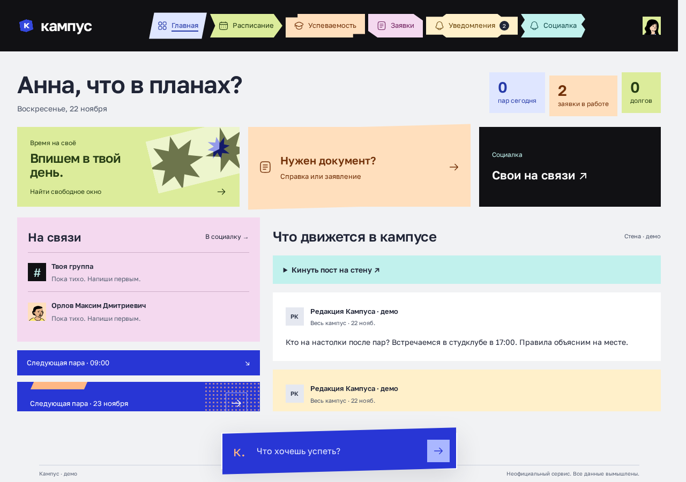
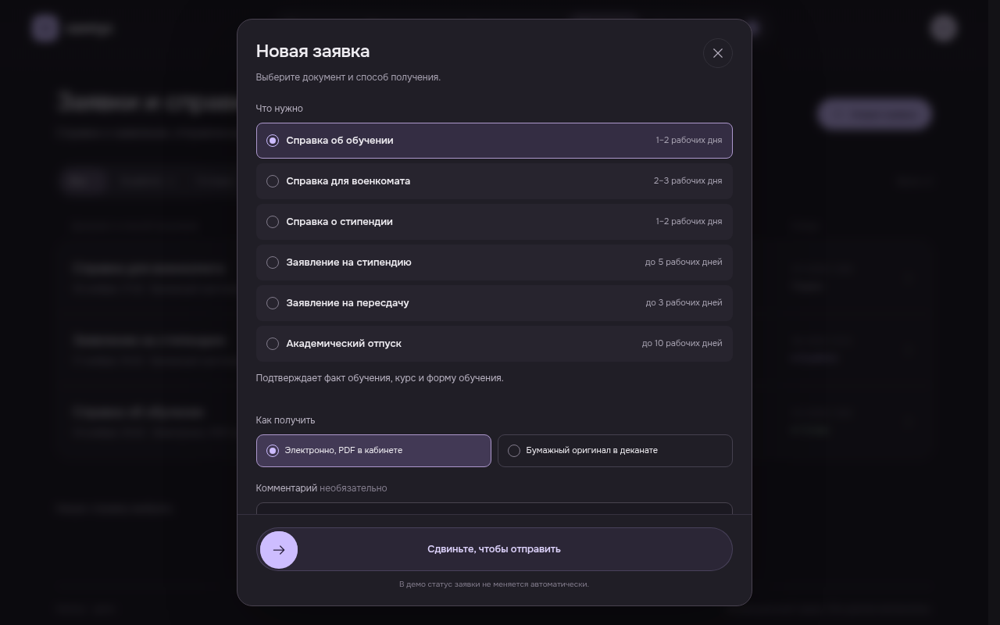
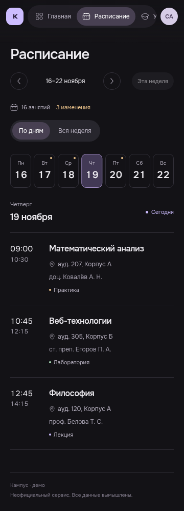

# кампус

Демо-прототип личного кабинета студента для конкурса. Здесь расписание с изменениями, оценки, заявки и уведомления. Вход один: сервер отдаёт студенту только его данные.

Прототип не связан с университетом. ФИО, оценки, номера зачёток, заявки и объявления вымышлены. Логотипа университета в интерфейсе нет: только нейтральный знак «К».

**Демо:** до 28 ноября 2026. Открывается без VPN: всё приходит с одного сервера, внешних CDN нет.



## Тестовые аккаунты

| Логин | Пароль | Кто это |
| --- | --- | --- |
| `anna` | `kampus2026` | Анна Смирнова, 3 курс, ПИ-23-1, факультет цифровых технологий |
| `maksim` | `kampus2026` | Максим Орлов, 2 курс, ЭК-24-2, факультет экономики и управления |

У аккаунтов разные расписания, оценки, заявки и уведомления.

## Что умеет

- Вход по логину и паролю, профиль с данными из деканата.
- Расписание на неделю. Сегодняшний день, переносы, замены и отмены. На узких экранах — выбор дня.
- Успеваемость по семестрам: оценки, зачёты, средний балл, список экзаменов.
- Заявки шести типов: справки об обучении, для военкомата, о стипендии, заявления на стипендию, пересдачу и академический отпуск. Статус, история и комментарий деканата. Готовую электронную справку можно скачать как демонстрационный PDF.
- Уведомления с категориями, отметкой «прочитано» и счётчиком в меню.
- Мобильная вёрстка от 360 px.

## Стек

- Backend: Python 3.11+, Flask 3, PyMongo, MongoDB 7.
- Frontend: React 19, React Router, Vite 8.
- Стили: собственные CSS-токены, локальный вариативный шрифт Onest через `@fontsource`, локальные Solar Icons.
- Framer Motion для состояний элементов; кнопка «сдвиньте, чтобы отправить» адаптирована из Bencho. Старое поле с поднимающейся подписью сохранено в исходниках, но не используется.

## Локальный запуск

Нужны Python 3.11+, Node.js 22+ и MongoDB 7.

```bash
# 1. Backend
cd backend
python3 -m venv .venv
.venv/bin/pip install -r requirements.txt
cp .env.example .env
.venv/bin/python seed.py
.venv/bin/python app.py
```

Flask слушает `http://127.0.0.1:5000`.

```bash
# 2. Frontend, второй терминал
cd frontend
npm ci
npm run dev
```

Откройте `http://localhost:5173`. Vite проксирует `/api` на Flask, поэтому CORS в разработке не нужен.

### Сборка без Vite

```bash
cd frontend
npm ci
npm run build
```

Flask отдаёт `frontend/dist` с того же адреса `http://127.0.0.1:5000`. Этот режим ближе к публикации.

### Пересоздать демо-данные

```bash
cd backend
.venv/bin/python seed.py
```

Скрипт удаляет пользователей, занятия, оценки, заявки и уведомления в базе `campus_demo`, затем загружает их заново. Пароли хранятся как scrypt-хеши.

## Проверка сценариев

1. Войдите под `anna`, откройте «Расписание» и переключите неделю. Вернитесь к текущей кнопкой «Эта неделя».
2. На «Успеваемости» переключитесь между 5 и 4 семестрами.
3. В «Заявках» создайте справку: выберите тип, способ получения и сдвиньте кнопку вправо.
4. Откройте «Уведомления», нажмите на карточку и проверьте, что счётчик уменьшился. Кнопка «Прочитать все» отмечает остальные прочитанными.
5. Выйдите и войдите под `maksim`. Главная, расписание, оценки и заявки будут другими.
6. Под `maksim` откройте ссылку на заявку Анны. Сервер вернёт 404, интерфейс покажет «Заявка не найдена».
7. Сузьте окно браузера до 360 px. Шапка остаётся в одну строку, основные разделы доступны в нижней панели. Горизонтальная прокрутка всей страницы не нужна; недельное расписание прокручивается внутри своего блока.

### Браузерные тесты

При запущенном Flask с собранным фронтендом:

```bash
cd frontend
npm test
npm run test:ui
```

Playwright проверяет вход, клики по вкладкам без перезагрузки, расписание, семестры, форму заявки, фокус в диалоге, уведомления, загрузку, ошибки API и изоляцию студентов на ширинах 360, 768 и 1280 px. Дополнительно проверяются промежуточные и конечные положения индикаторов, изменение высоты списков, быстрые переключения вкладок, жесты окна заявки, сохранение формы после ошибки и reduced motion. Отправка заявки и отметки уведомлений подменяются в браузере, чтобы тесты не меняли демо-базу. Изоляция проверяется через настоящий API. `npm test` отдельно проверяет физическую модель закрытия окна.

По умолчанию используются `http://127.0.0.1:5000` и `/usr/bin/chromium`; переопределение — `UI_BASE_URL` и `CHROMIUM_PATH`. Тестовые cookie сохраняются в игнорируемую папку `frontend/.playwright/`.

### Текущая вёрстка

Все экраны используют `frontend/src/styles/app.css`; прежние `base.css`, `pages.css` и `meow-theme.css` не подключаются. Шапка содержит прокручиваемые вкладки и восемь слоёв прогрессивного blur. View Transitions API анимирует только содержимое страницы: шапка остаётся живой. Без API работает короткое появление содержимого; reduced motion отключает перемещение.

Общие состояния собраны в `frontend/src/components/Motion.jsx`: перемещающийся индикатор выбора, смена содержимого с измеренной высотой, раскрытие блоков, счётчики и загрузка. `frontend/src/motion.js` задаёт параметры движения. Окно заявки использует пружину и пороги жестов Meow Client; блокировка фоновой страницы и фокус сохраняются до конца закрытия. Переход к созданной заявке начинается после выхода окна.

Компоненты управления остаются собственными React-компонентами; shadcn/ui пока не подключён.

Сохранённые версии фронтенда:
- `backups/frontend-before-meownet-20261119.tar.gz`;
- `backups/frontend-before-system-rebuild-20261119.tar.gz`;
- `backups/frontend-before-motion-audit-20261119.tar.gz` — перед доработкой состояний и анимаций.

## Публикация на VPS

Ниже минимальная схема для одного сервера в России. Нужны Node.js 22+, Python 3.11+ и MongoDB 7. Домен и IP подставьте свои.

### 1. Подготовка

```bash
sudo apt update
sudo apt install -y python3-venv nginx certbot python3-certbot-nginx
# MongoDB 7 поставьте из официального репозитория:
# https://www.mongodb.com/docs/manual/administration/install-on-linux/
```

Скопируйте проект в `/opt/campus`. Соберите фронтенд:

```bash
cd /opt/campus/frontend
npm ci
npm run build
```

Создайте окружение и заполните `.env`:

```bash
cd /opt/campus/backend
python3 -m venv .venv
.venv/bin/pip install -r requirements.txt
cp .env.example .env
python3 -c "import secrets; print(secrets.token_urlsafe(48))"
```

В `.env`:

```dotenv
APP_ENV=production
MONGO_URI=mongodb://127.0.0.1:27017
DB_NAME=campus_demo
JWT_SECRET=<длинная случайная строка из команды выше>
JWT_TTL_HOURS=12
COOKIE_NAME=campus_session
COOKIE_SECURE=1
FRONTEND_ORIGINS=https://campus.example.ru
LOGIN_RATE_LIMIT=10
LOGIN_RATE_WINDOW=300
TRUST_PROXY=1
```

Загрузите демо-данные:

```bash
.venv/bin/python seed.py
```

MongoDB оставьте на `127.0.0.1`, порт `27017` закройте файрволом. Flask слушает только localhost, наружу открыт nginx.

### 2. systemd

Файл `/etc/systemd/system/campus.service`:

```ini
[Unit]
Description=campus demo
After=network.target mongod.service

[Service]
User=www-data
Group=www-data
WorkingDirectory=/opt/campus/backend
EnvironmentFile=/opt/campus/backend/.env
ExecStart=/opt/campus/backend/.venv/bin/gunicorn -w 2 -b 127.0.0.1:5000 app:app
Restart=always
RestartSec=3

[Install]
WantedBy=multi-user.target
```

```bash
sudo chown -R www-data:www-data /opt/campus
sudo systemctl daemon-reload
sudo systemctl enable --now campus
curl http://127.0.0.1:5000/api/health
```

### 3. nginx и HTTPS

Готовый пример: [`deploy/nginx.conf.example`](deploy/nginx.conf.example). Замените `campus.example.ru` на свой домен, затем получите сертификат:

```bash
sudo certbot --nginx -d campus.example.ru
```

`COOKIE_SECURE=1` включайте только после того, как сайт открывается по HTTPS. Иначе браузер не отправит cookie и вход не сработает.

### 4. Что проверить после публикации

```bash
curl -I https://campus.example.ru
curl https://campus.example.ru/api/health
```

- `Content-Security-Policy`, `X-Frame-Options: DENY`, `X-Content-Type-Options: nosniff` и `Permissions-Policy` есть в ответе.
- `/api/dashboard` без cookie возвращает 401.
- Вход работает по HTTPS, cookie `campus_session` помечена `HttpOnly` и `Secure`.
- В Network нет запросов на чужие домены: страница и шрифты приходят с вашего.

## Безопасность

| Что сделано | Где |
| --- | --- |
| Пароли хранятся как scrypt-хеши | `backend/auth.py` |
| JWT в httpOnly-cookie, `SameSite=Lax`, срок 12 часов | `backend/auth.py`, `backend/config.py` |
| Запросы на изменение проверяют `Origin` | `backend/app.py` |
| Ограничение попыток входа: 10 за 5 минут на IP+логин | `backend/auth.py`, `backend/api.py` |
| Оценки, заявки и уведомления фильтруются по `user_id` из токена | `backend/api.py` |
| Чужая заявка возвращает 404, а не 403 с подсказкой о существовании | `backend/api.py` |
| CSP, `X-Frame-Options: DENY`, `nosniff`, HSTS за HTTPS, `Permissions-Policy` | `backend/app.py` |
| Секреты только в `.env`, в браузер не попадают | `backend/config.py`, `frontend/src` |

Ограничения демо: счётчик попыток входа живёт в памяти процесса, поэтому у каждого gunicorn-воркера он свой. Статусы заявок не меняются: обработки на стороне деканата в демо нет. Пароли `anna` и `maksim` опубликованы намеренно: это тестовые аккаунты, а не секреты. База не рассчитана на реальные персональные данные.

## Соответствие требованиям конкурса

| Требование | Реализация |
| --- | --- |
| Вход и профиль | `/login`, `/profile`, JWT-cookie |
| Расписание на сегодня и неделю | `/` и `/schedule`, переносы, замены, отмены |
| Оценки | `/grades`, семестры, средний балл, сессия |
| Заявки и справки | `/requests`, шесть типов, статусы и история |
| Уведомления | `/notifications`, категории, прочитано, счётчик |
| Два студента с разными данными | `anna` и `maksim` |
| Мобильная версия от 360 px | проверено в Chromium на 360, 390, 768, 1024 и 1440 px |
| Без официального брендинга | нейтральный знак «К», дисклеймер на входе и в кабинете |
| Без VPN | нет внешних CDN и API, шрифты лежат в сборке |
| Студент видит только свои данные | фильтрация на сервере, 404 на чужую заявку |
| Секреты не в коде и не в браузере | `.env`, httpOnly-cookie |

## Скриншоты

Новая заявка на десктопе:



Расписание на телефоне, 360 px:



## Структура

```text
backend/
  api.py            маршруты API
  auth.py           пароли, JWT, ограничитель входа
  services.py       сборка расписания, оценок и главной
  serializers.py    ответы в camelCase
  seed.py           вымышленные данные и два аккаунта
  app.py            Flask, безопасные заголовки, раздача React
frontend/
  src/pages/        экраны кабинета
  src/components/   навигация, модальное окно, состояния
  src/bencho/       адаптированные компоненты Bencho
  src/styles/       app.css и переходы страниц
  tests/ui/         браузерные проверки
deploy/
  nginx.conf.example
  campus.service.example
docs/screenshots/   скриншоты для README
```

## API

Все маршруты начинаются с `/api`.

| Метод | Маршрут | Что делает |
| --- | --- | --- |
| `GET` | `/health` | проверка, что API отвечает |
| `POST` | `/auth/login` | вход, ставит cookie |
| `POST` | `/auth/logout` | удаляет cookie |
| `GET` | `/auth/me` | текущий пользователь |
| `GET` | `/dashboard` | сводка на главную |
| `GET` | `/schedule?week=0` | расписание на неделю |
| `GET` | `/grades` | оценки по семестрам |
| `GET` | `/requests` | заявки и типы |
| `POST` | `/requests` | создать заявку |
| `GET` | `/requests/<id>` | заявка с историей |
| `GET` | `/notifications` | уведомления |
| `POST` | `/notifications/<id>/read` | отметить одно |
| `POST` | `/notifications/read-all` | отметить все |

## Bencho и лицензии

Кнопка подтверждения адаптирована из SlideConfirm в [Bencho](https://bencho.dev/) (MIT): русские подписи, async-подтверждение, сброс при ошибке и ширина по контейнеру. Ранее адаптированное поле LabelInput сохранено в `frontend/src/bencho/`, но больше не используется на экране входа. Комментарии об авторстве и лицензия сохранены; уведомления лежат в [THIRD_PARTY_NOTICES.md](THIRD_PARTY_NOTICES.md).

Текущий шрифт Onest распространяется по SIL Open Font License и поставляется вместе со сборкой. Иконки — Solar, CC BY 4.0.
