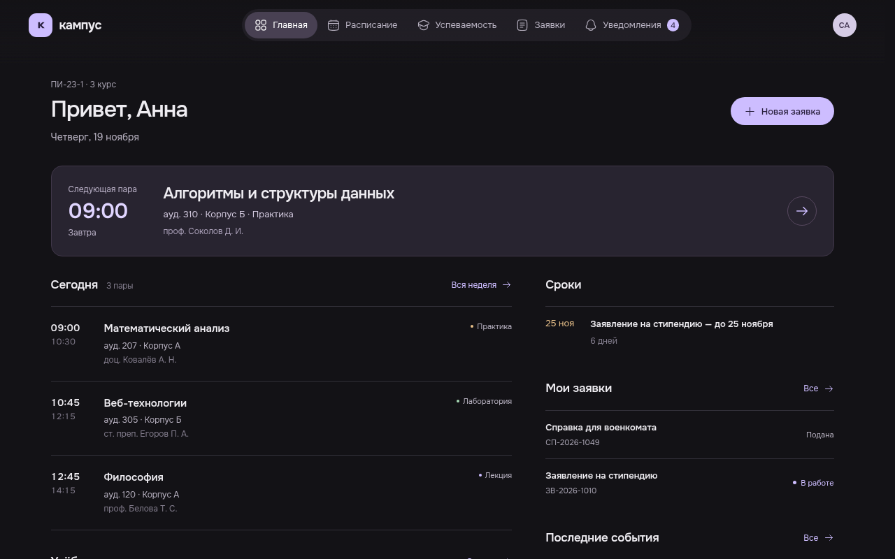
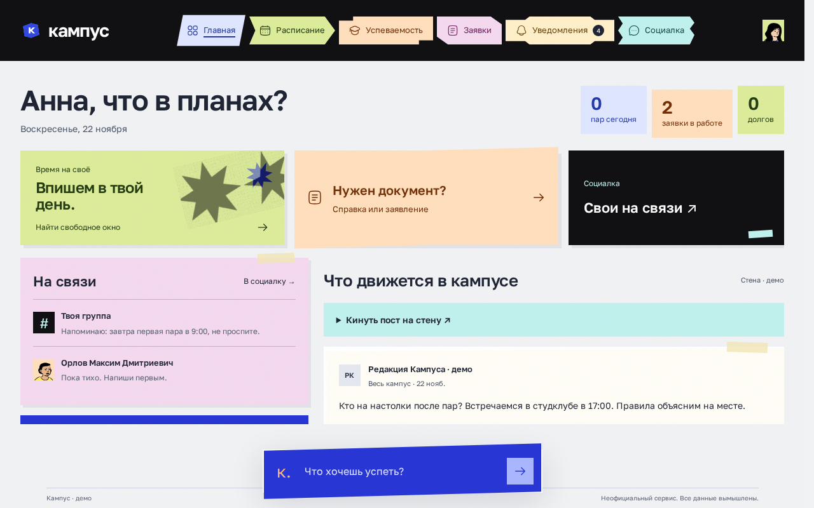
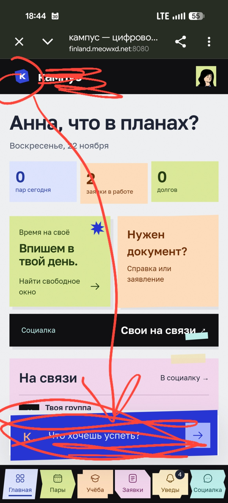
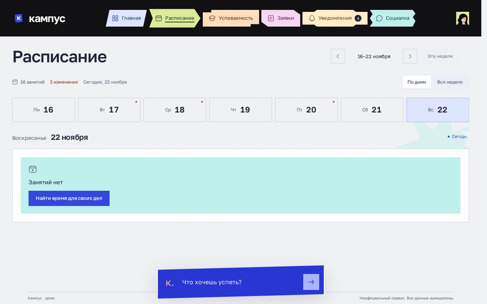
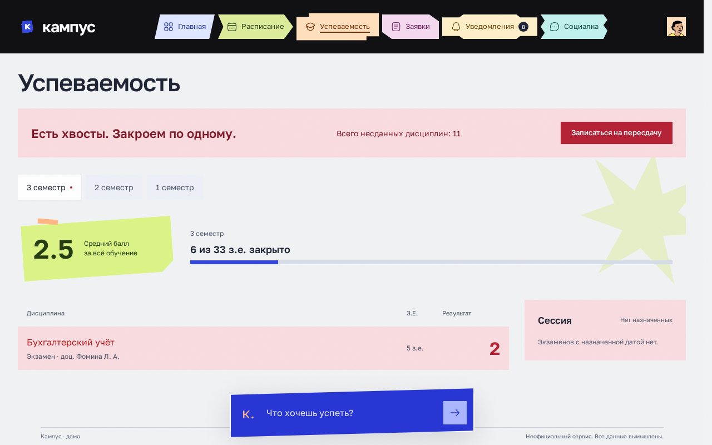
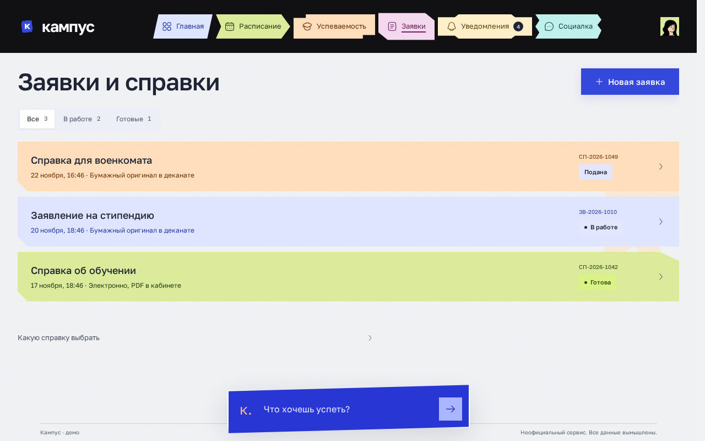
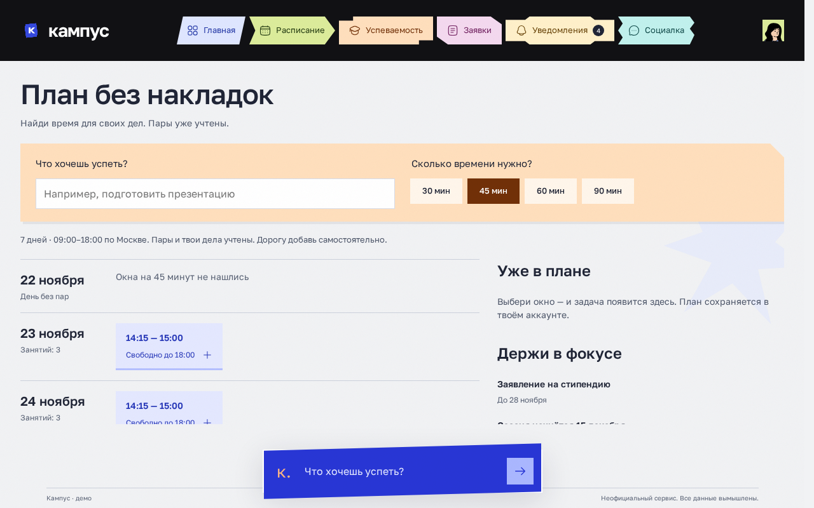
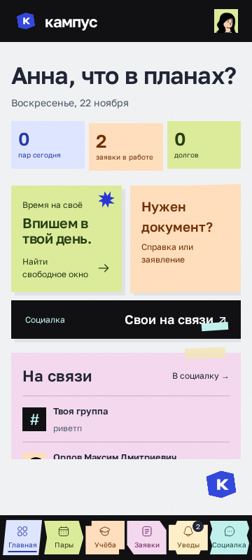
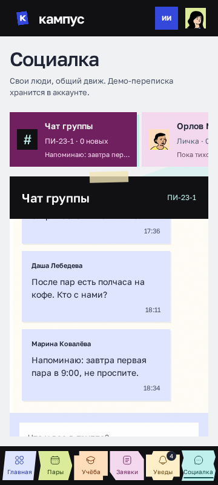

# Кампус: как создавался цифровой деканат

Конкурсный прототип личного кабинета студента. Отчёт о замысле, работе с ИИ и проверке результата, 22 ноября 2026 года.

Работающий кабинет: **https://campus.mxd.wtf**. Тестовые аккаунты приведены в разделе 2; устройство публикации — в [deployment.md](deployment.md).

Кампус — неофициальный концепт. Студенты, преподаватели, группы, оценки, документы и переписка вымышлены. Прототип не подключён к системам университета. Собственный знак «К» не копирует официальный логотип вуза.

## 1. Проблема и замысел

Студенту приходится искать расписание, оценки, сроки и справки в разных системах. Одно объявление оказывается в чате, другое — на сайте, а заявление всё ещё требует отдельного обращения. Кампус собирает эти задачи в одном кабинете и связывает сведения с действием: из переноса можно перейти в расписание, из учебной проблемы — к подготовке или заявке на пересдачу, из предложения помощника — к свободному времени в личном плане.

Обязательное ядро определило состав разделов: вход и профиль, расписание, успеваемость, заявки и уведомления. Они отвечают на пять вопросов: кто я в системе, куда идти, как идёт учёба, как получить документ и что нельзя пропустить. Социальная часть дополняет кабинет стеной, чатом группы и личкой. Это отдельная область: личные уведомления о документах не становятся публичными постами.

Подтверждённого опроса однокурсников в материалах проекта нет. Проблема взята из конкурсного задания; продуктовые и визуальные решения уточнялись по замечаниям автора и проверкам прототипа. Две учебные истории помогают проверить разные потребности: Анна учится без долгов, у Максима есть задолженности, низкое посещение и просроченные задачи. Это заранее созданные демонстрационные сценарии.

## 2. Что получилось

| Задача студента | Сценарий в прототипе |
| --- | --- |
| Войти и проверить сведения | Вход по логину и паролю; профиль с ФИО, факультетом, направлением, курсом и группой |
| Узнать, где следующая пара | День и неделя, аудитория и преподаватель, переносы, замены и отмены; непрерывная лента дней |
| Понять положение с учёбой | Дисциплины, оценки и зачёты, семестры, сессия, общий средний балл; разные состояния двух аккаунтов |
| Получить справку | Создание заявки, способ получения, история и статус; скачивание демонстрационного PDF для готовой электронной справки |
| Не пропустить срок | Уведомления с категориями, прочтением и переходом к связанному действию |
| Найти время на подготовку | Свободные окна с учётом занятий и личных задач; сохранение задачи после выбора студентом |
| Разобраться, с чего начать | ИИ-помощник объясняет сведения текущего аккаунта и предлагает действия и подготовительные задачи |
| Связаться со своими | Стена кампуса/группы, чат своей группы и личные диалоги с сохранением на сервере |

Сильная дополнительная идея — связка «понять проблему → найти время → сохранить действие». Помощник не обещает решить учебную проблему за студента: он предлагает следующий шаг, а студент подтверждает запись. Планировщик проверяет доступность ещё раз перед сохранением и сообщает о конфликте, если окно уже занято.

Демо-аккаунты: `anna` / `kampus2026` и `maksim` / `kampus2026`. Учебные данные и заявки у них разные. Кабинет сотрудника не реализован; демо показывает заранее подготовленные статусы и историю заявок. Автоматическая обработка настоящих документов в задачу прототипа не входит.

## 3. Какие свидетельства сохранились

Источники отчёта: [исходное задание](task.htm), [история замечаний и проверок](superpowers/plans/2026-11-21-review-queue.md), [продуктовые требования](../PRODUCT.md), [визуальные правила](../DESIGN.md), Git и скриншоты. [Архитектура](architecture.md) и [API](api.md) описывают устройство действующей версии.

Первая идея и ранние разговоры с ассистентами не сохранились в виде полной переписки. Поэтому ниже явно разделены сведения из кода и Git, сведения со слов автора и реконструкция постановок задач. Скриншот готовой страницы не выдаётся за снимок диалога или раннего макета. Самостоятельного Figma-макета среди подтверждённых артефактов нет.

| Артефакт | Что подтверждает |
| --- | --- |
| `3d85881`, 20 ноября | Уже существовали Flask/MongoDB, React, обязательные учебные разделы, демо-данные и браузерные проверки |
| `0086ffc`, 21 ноября | Завершены скачивание PDF, проверки доступа к документу, обработка неверного JSON и мобильная навигация |
| `823dc29`, 22 ноября | Добавлены личный план, серверный помощник, истории семестров и новая композиция кабинета |
| `fe00674`, 22 ноября | Уточнён угловатый pop-art стиль, добавлены документы для дальнейшей работы ИИ-агентов |
| `90c9f59`, 22 ноября | Добавлены стена и чаты, новые предметные экраны, стабильные реакции поверхностей и подгрузка расписания |
| `63c7b53`, 22 ноября | Добавлены бумажные материалы, вступительные сообщения и исправления независимого аудита GLM-5.3 через OpenCode |
| `c7bb970`, 22 ноября | Опубликован campus.mxd.wtf, подключён OpenRouter, на телефоне помощник открывался кнопкой ИИ (исторический этап) |
| Скриншоты в `docs/screenshots/` | Реальные виды ранней и поздней работающих версий; это не полный архив каждого шага |

Даты и состав изменений можно сверить командой `git show --stat <commit>`. Коммиты подтверждают изменения файлов, но сами по себе не доказывают, какой ассистент написал каждую строку.

## 4. Инструменты и роль каждого

На вопрос об инструментах автор указал Codex и сообщил, что оригинальных логов нет. Отдельно сохранённая очередь и коммит `63c7b53` документируют запуск Codex внешнего аудита через OpenCode с моделью GLM-5.3. Это подтверждение по журналу выполненной работы, а не первичный лог модели. Ранние упоминания VS Code, Zed и DeepSeek harness не подтверждены текущим ответом автора и не включены в перечень фактически использованных инструментов.

| Инструмент или сервис | Для чего использован | Основание |
| --- | --- | --- |
| Codex | Анализ задания и репозитория, постановка и выполнение изменений, ревью, проверки и документация | Текущий проход с ИИ-ассистентом; документы и проверяемые изменения в рабочем дереве |
| Субагенты Codex | Независимый аудит соответствия ТЗ, публичная проверка, подготовка отчёта и разбор дефектов параллельно основному прогону | Задачи текущего финального прохода; результат проверяется основным агентом |
| OpenCode, GLM-5.3, провайдер zai-anthropic | Независимый аудит кода и интерфейса, организованный Codex | Журнал очереди и этап `63c7b53`; полный исходный диалог не сохранён |
| Навыки ИИ-агента, Modern Web Guidance и Impeccable | План, проверка перед завершением, рекомендации по доступности и React, визуальный просмотр и механическая проверка UI | Текущие команды и инструкции; это инструменты/правила работы, а не дополнительные модели |
| Check-Host | HTTP-проверка публичного сайта с трёх российских узлов | Сохранённый ответ и ссылка на результат в разделе публикации |
| OpenRouter, NVIDIA Nemotron | Основной живой провайдер встроенного помощника: `nvidia/nemotron-3-ultra-550b-a55b:free` | `backend/assistant.py`, `c7bb970`, публичный запрос HTTP 200 с `provider: OpenRouter` |
| Pollinations | Резерв встроенного помощника при ошибке или лимите основного провайдера | В режиме `auto` сервер сообщает фактически ответившего провайдера; код и серверные проверки |
| DeepSeek | Реализован настраиваемый адаптер помощника | Живой вызов не подтверждён: серверный ключ отсутствует; не засчитывается как успешно использованная модель |
| nginx, gunicorn, systemd, Let’s Encrypt | Публичный HTTPS-прототип, запуск и перезапуск сервиса, TLS | [Схема публикации](deployment.md), конфигурации `deploy/` |
| Playwright / Chromium | Автоматические пользовательские сценарии, проверки геометрии, получение изображений интерфейса | `frontend/tests/ui/`, конфигурация и сохранённые скриншоты |
| Node test runner, Python unittest | Проверки логики анимации/куба и серверных сценариев | `frontend/tests/`, `backend/tests/` |
| Git | Сохранение вариантов и проверяемая история изменений | История репозитория |
| React, Flask, MongoDB, Vite | Клиент, API, сохранение данных и сборка | Исходный код и файлы зависимостей |
| Framer Motion, Paper Shaders | Переходы, реакции и выборочный визуальный материал | Исходники компонентов и зависимости; это библиотеки, а не генераторы дизайна |
| Golos Text, Solar Icons, Open Peeps | Локальный шрифт, иконки и разные иллюстрированные аватары | Файлы проекта и сведения об источниках в `THIRD_PARTY_NOTICES.md` |
| Bencho | Исходный компонент подтверждения, адаптированный под русские подписи, асинхронную отправку и восстановление после ошибки | `frontend/src/bencho/` и сохранённая атрибуция |
| ReportLab и Noto Sans | Формирование демонстрационной справки в PDF | `backend/documents.py`, зависимости и локальный шрифт |

Дизайн и тексты уточнялись через задания ИИ-ассистенту и изменения в коде. Отдельный сервис генерации изображений, отдельная ИИ-система для текстов и использование Figma в доступных свидетельствах не подтверждены. Аватары Open Peeps — готовые разрешённые иллюстрации, а не доказательство генерации картинок нейросетью. Звёзды и фирменная графика реализованы SVG/CSS/canvas.

В очереди зафиксирован промежуточный адаптер Gemini, заменённый Pollinations по просьбе автора; успешный живой вызов Gemini не подтверждён. Позднее добавлены DeepSeek и OpenRouter. На основной публичной копии используется OpenRouter/Nemotron, а Pollinations сохранён как резерв. В `auto` при заданных ключах порядок выбора — DeepSeek, затем OpenRouter; при ошибке выбранного провайдера выполняется одна попытка Pollinations. DeepSeek-адаптер проверен подменой ответа, но не живым запросом. Бесплатный OpenCode Zen не подключён к продукту: попытки интеграции зафиксированы как неуспешные. Не следует смешивать этот endpoint с использованием OpenCode как инструмента аудита.

## 5. Постановка задач ИИ

Дословный фрагмент основного запроса текущего финального прохода: «сделал финальный прогон по всему проекту, перепроверил все ли есть что в тз». Практический смысл — сначала сопоставить критерии с реализацией и свидетельствами, затем выполнить проверки и обновить материалы подачи.

Следующие примеры — **реконструкция по результатам и очереди**, а не найденные оригинальные диалоги. Они показывают структуру постановки задач: контекст, ограничения, проверяемый результат.

**Обязательное ядро.** «Сделай кабинет студента на вымышленных данных: вход, профиль, расписание, оценки, заявки и уведомления. Подготовь два разных аккаунта. Данные должны приходить с сервера и оставаться после перезагрузки. Покажи мобильную версию от 360 px». Результат этапа отражён в `3d85881`.

**Документы и безопасность.** «Готовая электронная справка должна скачиваться как демо-PDF. Проверь, что другой студент не скачает документ даже по известному ID. Неверное JSON-тело должно давать понятную ошибку, а не 500». Результат — `0086ffc`, `backend/tests/test_documents.py` и `test_request_body.py`.

**Действие вместо лишних сводок.** «Разбери назначение каждого блока. Свяжи учебную проблему с действием. Найди свободные окна с учётом расписания и личного плана; запись — после выбора студента. Не удаляй созданные заявки и задачи при обновлении демо». Результат — `docs/block-audit.md`, `planner.py`, `Plan.jsx` и `823dc29`.

**ИИ в продукте.** «Передавай помощнику только необходимый контекст текущего демо-студента. Пусть объясняет сведения и предлагает ограниченный набор действий. Он не должен сам записывать задачи, отправлять заявления или получать переписку». Результат — серверный адаптер и проверка ответа, переход к ручному подтверждению в планировщике.

**Визуальный язык и доступность.** «Сохрани максимализм: угловатые формы, звёзды и выборочный pop-art растр. Цвет должен обозначать раздел или состояние. Не двигай текст и фокус вместе с декоративным скосом. Реакции заканчиваются устойчивым состоянием; reduced motion отключает перемещение». Результат — `DESIGN.md`, общие компоненты движения и `ReactiveSurface`.

**Социальная часть.** «Добавь стену, чат группы и личку. Сервер проверяет группу и обоих участников лички. Повтор отправки с UUID не создаёт дубликат. Лента хранит ограниченное окно DOM; личные уведомления и сообщения не попадают в ИИ». Результат — `90c9f59`, `social.py`, `NewsWall.jsx`, `Social.jsx` и серверные тесты.

В действующем коде сохранилась и реальная инструкция встроенной модели. Короткий дословный фрагмент из `backend/assistant.py`: «Используй только переданный контекст текущего студента. Не придумывай оценки, сроки, правила вуза или сохранение действий». Далее задан JSON-формат ответа, разрешённые действия и пределы подготовительных задач. Это проверяемый промпт продукта, не реконструкция переписки о разработке.

## 6. Итерации и работа с ошибками

ИИ-результат неоднократно проверяли и переделывали. Журнал сохранил как функциональные ошибки, так и неудачные композиционные решения.

| Обнаружено | Почему это мешало | Что изменено и где искать свидетельство |
| --- | --- | --- |
| Неверное JSON-тело приводило к 500 | Ошибка клиента превращалась в сбой сервера | Проверка объекта и ответ 400; `test_request_body.py`, `0086ffc` |
| Готовый PDF был обещан интерфейсом, но не скачивался | Сценарий получения справки не завершался | Защищённый маршрут скачивания и кнопка; `documents.py`, `0086ffc` |
| На телефоне основные разделы были видны не все | Главная навигация требовала лишнего поиска | Переработана нижняя панель; очередь и мобильные скриншоты |
| Главная превращалась в набор сводок и пустых блоков | Экран давал сведения без ясного следующего шага | Аудит назначения блоков, сжатие пустого дня, связанные действия; `block-audit.md` |
| Помощник перекрывал содержимое на телефоне | Нельзя было воспользоваться нижним действием | Сначала выделена отдельная полоса, затем постоянная мобильная панель заменена кнопкой ИИ в шапке; `c7bb970` и мобильные сценарии |
| Движение поверхности смещало область наведения | Курсор у края повторно включал/выключал реакцию | Неподвижный внешний контейнер и движущийся внутренний слой; `ReactiveSurface.jsx` |
| Подгрузка и прочтение в чате требовали уточнений | Новые сообщения могли считаться прочитанными при просмотре старой истории | UUID повтора, последовательный polling, явный переход вниз, тест истории из 130 сообщений; очередь и `social.spec.js` |
| Проверки считывали переход слишком рано | Измерения попадали в промежуточную анимацию | Ожидание устойчивой геометрии и кадров; очередь содержит неуспешные и повторные результаты |
| Независимый аудит GLM выявил P1/P2 | Требовались более строгие Host/Origin, лимиты социальных действий и последовательные состояния UI | Исправлены проверка Host/Origin, JSON-404 API, лимиты, пустые чаты и тексты; очередь и `63c7b53` |
| Reasoning-модель обрезала JSON | При лимите 1800 токенов основной ответ не завершался | Для OpenRouter увеличен предел до 4096; живой вызов после изменения вернул `provider: OpenRouter`, `c7bb970` |

Внешний вид тоже проходил несколько направлений: ранний тёмный кабинет, светлая компактная система, затем собственный выразительный стиль. Не каждое промежуточное направление сочли удачным: автор отказался от стандартной композиции dashboard/bento, широкого шрифта и случайного декора. Итоговые ограничения вынесены в `PRODUCT.md` и `DESIGN.md`, чтобы следующая генерация кода не возвращала отвергнутые решения.

Исторический вид перед переработкой, сохранённый 21 ноября. Это реальный экран работавшего прототипа, а не восстановленный макет:



Опубликованная версия после слоя «куски бумаги»: зерно, светлые подложки, клейкая лента и срезанные углы. Короткие частицы подтверждают публикацию поста или отправку сообщения, затем исчезают; reduced motion их отключает. Скриншот ниже получен с публичного сайта в финальном проходе 22 ноября:



В финальном проходе автор прислал размеченный снимок телефона и уточнил расположение входа в помощника. Это сохранившееся реальное замечание текущей сессии: «перенести куб вниз», «из шапки ничего не убирать». Поэтому внизу появился компактный куб, открывающий панель, а логотип и название остались в шапке. Ниже — исходное замечание, не финальный результат.



## 7. Визуальный результат и мобильные сценарии

Основной шрифт — локальный Golos Text. Форма вкладок помогает различать разделы, а внутри страниц цвет связан с результатом или состоянием: срок, ожидание, готовность, учебная проблема. Тексты и поля сохраняют прямое положение. Состояния загрузки, ошибки, пустого списка и повторной попытки оформлены в интерфейсе.

Непрерывное движение сосредоточено в маленьком кубе логотипа: нажатием его можно остановить. При reduced motion куб статичен, перемещения отключены. Декор не должен обрезать клавиатурный фокус. В отправке заявки предусмотрена обычная кнопка как альтернатива жесту. Критические учебные сценарии работают независимо от декоративных шейдеров и внешнего помощника.

Расписание: день, занятия и переход к личному плану; отдельная горизонтальная лента продолжает подгружать недели.



Успеваемость Максима на публичном сайте: 11 незакрытых дисциплин и действие «Записаться на пересдачу». Общий средний балл закреплён отдельно от выбранного семестра; дисциплины раскрываются для подробностей. Это вымышленная учебная история, отличная от аккаунта Анны.



Заявки: тип, статус и действие собраны вместе. Скачивание доступно для готовой электронной справки.



Планировщик: выбранная длительность, даты и доступные окна превращают намерение в личную задачу.



На телефоне личный контекст и чаты расположены перед стеной, чтобы подгрузка постов не отодвигала основные действия. По последнему уточнению автора помощник открывается компактным кубом внизу вместо длинной свёрнутой полосы. Логотип и название в шапке сохранены; закрытие возвращает клавиатурный фокус к кубу. В нижней навигации использованы короткие подписи «Пары», «Учёба», «Уведы».



Социалка на телефоне: список диалогов и история чата группы. В группах есть семь вступительных сообщений от вымышленных сокурсников: это помеченные снимки авторов `demo_author`, а не скрытые дополнительные аккаунты. Повторная загрузка этих демо-записей не создаёт дубли. Личка сохраняет отдельное пустое состояние до начала переписки.



Остальные виды публичного сайта из этого прохода: [уведомления](screenshots/final-public-notifications.png), [профиль](screenshots/final-public-profile.png), [социалка на компьютере](screenshots/final-public-social.png), [расписание на телефоне](screenshots/final-public-schedule-mobile.png). Снимки с префиксом final-public сняты с опубликованного сайта, final-local — с проверенной локальной версии после последней правки. Они не заменяют проверку поведения.

## 8. Как устроены вход, хранение и защита

Браузер показывает React-интерфейс, Flask обрабатывает запросы, MongoDB хранит данные. После входа сервер выдаёт ограниченную по времени сессию в HttpOnly cookie: скрипт страницы не читает её содержимое. Пароль проверяется по scrypt-хешу; исходный пароль в базе не хранится. При выходе cookie удаляется.

Сервер определяет текущего студента из сессии. Он не доверяет `user_id`, который мог бы прислать браузер. Оценки, заявки и задачи выбираются по владельцу; расписание — по группе, уведомления — по доступной аудитории. Запрос чужой заявки или документа возвращает 404. Знание адреса или ID не даёт права доступа.

В чат группы допускается только участник этой группы. Для личного диалога проверяются оба существующих участника и принадлежность текущего студента к ним. Уникальный UUID отправки защищает от дубликата при повторе после сетевой ошибки. Личные сообщения не передаются внешнему ИИ и не становятся постами стены.

Сервер проверяет JSON, допустимые значения и длину текста, отклоняет изменяющие запросы с чужим Origin. Ключи и настройки сервера берутся из окружения; файл `.env` не предназначен для репозитория или браузера. На опубликованной копии включены HTTPS и защищённые cookie; параметры и секреты хранятся только на сервере. Публичная проверка подтвердила `HttpOnly; Secure; SameSite=Lax`.

Внешний помощник получает только учебный контекст текущего демо-аккаунта: сведения, необходимые для ответа, без паролей, cookie и переписки. Он возвращает текст и предложения. Сервер проверяет структуру ответа и сам формирует разрешённые ссылки. Запись в план и отправка заявки требуют действия студента. Ошибка провайдера не блокирует расписание, заявки и личный план.

Для масштабирования сохранены границы клиента, API и базы, используются индексы и курсорная подгрузка. При этом текущий прототип не проходил нагрузочную аттестацию. Ограничитель частоты живёт в памяти процесса; для нескольких серверных экземпляров понадобится общий счётчик. Это конкретная граница демо, а не заявление о готовности обслуживать весь вуз.

## 9. Проверка результата

После получения обновлённой ветки до `c7bb970` старый локальный прогон не считается проверкой новой версии. Итоги разделены по области и времени.

**Публичная версия, текущий финальный проход.** Пройдены 48 экранов двух аккаунтов на 360/768/1280 px и 19 проверок API. Проверялись авторизация, ответы основных разделов, раздельность заявок и сессионная cookie; проверки PDF, неверного JSON и Origin отдельно выполнены в серверных тестах. По результатам прохода нет горизонтального выхода страницы и ошибок JS. Живой запрос к помощнику вернул HTTP 200 и `provider: OpenRouter`; в одном ответе обнаружен служебный JSON-хвост, поэтому сам HTTP 200 не считается подтверждением качества всех ответов. Серверная проверка дополнена отклонением протокольных полей внутри текста и переключением на резерв. Две регрессии сначала воспроизвели дефект, затем прошли; повторная публикация проверяется отдельно.

**Окончательная локальная версия.** Серверные проверки — 35/35, frontend — 6/6, production-сборка завершилась успешно; полный Chromium после нижнего куба — 102/102 на 360/768/1280 px. Дополнительно настоящая заявка отправлена из формы на 360 px, сохранилась после перезагрузки и вернула 404 второму студенту. Проверочные записи удалены; рабочая база не сбрасывалась. По последнему указанию автора продакшен в этом проходе не обновлялся: нижний куб и защита от JSON-хвоста опубликованы в исходниках, а не на действующем сайте.

Исторические результаты предыдущих состояний кода сохранены в очереди. Окончательные числа ниже относятся к этому проходу; рабочая `campus_demo` ради тестов не сбрасывалась.

**Команды воспроизводимого прогона:**

```bash
# Из frontend/, последовательно: сначала сборка, затем браузерные проверки
npm test
npm run build
npm run test:ui

# Из корня, при работающей MongoDB и подготовленном окружении Python
PYTHONPATH=backend backend/.venv/bin/python -m unittest discover -s backend/tests -v
```

Браузерным проверкам нужен запущенный Flask и существующая демо-база. Ради проверки нельзя сбрасывать её через `seed.py`: он удаляет демо-данные, включая созданные личные задачи. Сборку и браузерный прогон нельзя выполнять одновременно, поскольку Flask раздаёт изменяемый `dist`.

Автотесты репозитория настроены на Chromium. Реальный прогон Firefox и Safari в сохранённых результатах не подтверждён. Проверки изоляции, сохранения и ошибок имеют больший вес, чем один скриншот благополучной главной страницы.

## 10. Что делал человек

По сохранённым материалам автор предоставил задание конкурса, выбирал направления интерфейса, присылал замечания и скриншоты проблем, уточнял лексику и требования к движению, задавал приоритеты и запрашивал повторные проверки. ИИ переводил эти решения в код, документы и проверочные сценарии. Корректировки не принимались автоматически по самому факту генерации.

Для управления работой появились отдельные файлы: `AGENTS.md` задаёт правила агенту; `PRODUCT.md` — цель и ограничения продукта; `DESIGN.md` — визуальные решения; очередь — незавершённые замечания и фактические проверки. Это помогает сохранять решения автора между сессиями и не терять ошибки после очередной генерации.

Другие ручные этапы — например, точная доля ручного программирования, подбор контента до появления Git или самостоятельное тестирование на физических телефонах — по доступным данным установить нельзя. Их не следует приписывать автору без подтверждения.

## 11. Публикация и материалы подачи

Прототип закрывает обязательные учебные сценарии и добавляет личный план, помощника и социальную часть. Оценку по четырём критериям выставляет жюри; отчёт не присваивает проекту баллы заочно.

Для подачи необходима публичная ссылка на работающий кабинет, два аккаунта, доступ к исходникам и этот отчёт в PDF или по ссылке. Видео до пяти минут — необязательное дополнение. Репозиторий и локальный адрес сами по себе не заменяют доступный жюри прототип.

Основной адрес — [campus.mxd.wtf](https://campus.mxd.wtf), стандартный HTTPS-порт 443. Схема: nginx с TLS → gunicorn/Flask → MongoDB; статика отдаётся отдельно. В документации размещения зафиксированы автозапуск, перезапуск сервиса и продление сертификата. Сертификат действует до 20 февраля 2027; это не заменяет мониторинг доступности до конкурсного срока 28 ноября. Дополнительно три российских узла Check-Host (два в Москве и один в Санкт-Петербурге) получили HTTP 200: [результат](https://check-host.net/check-report/59d8a456kd57), [сохранённые данные](russia-availability.json). Проверка не гарантирует работу в каждой сети абонента и будущую бесперебойность.

Для комментария к конкурсной работе нужны основной URL, `anna` / `kampus2026` и `maksim` / `kampus2026`, ссылка на исходники с доступом жюри и актуальный PDF этого отчёта. Старый резервный адрес на порту 8080 не используется как основной. Отправку в личный кабинет конкурса выполняет капитан команды.

Оригинальные диалоги прежних сессий утрачены — это уже уточнено автором. Взамен приложены проверяемая история изменений, журнал замечаний, реальные скриншоты и явно помеченные реконструкции задач. Внешний аудит GLM-5.3 через OpenCode указан на основании журнала оркестрации Codex. Полные логи аудита не выдаются за сохранившиеся.

Границы прототипа: отдельно проверялся Chromium; реальные Safari/Firefox и нагрузочные испытания не заявляются. Обработка документов демонстрационная, ограничители запросов хранятся в памяти процесса. Бесплатный внешний ИИ может ограничивать запросы; резерв и сообщение об ошибке предусмотрены, живой DeepSeek без ключа не подтверждён.

Публичные демо-пароли относятся только к вымышленным конкурсным аккаунтам. Сведения о разрешённых сторонних материалах и обязательная атрибуция хранятся отдельно от описания продукта.
